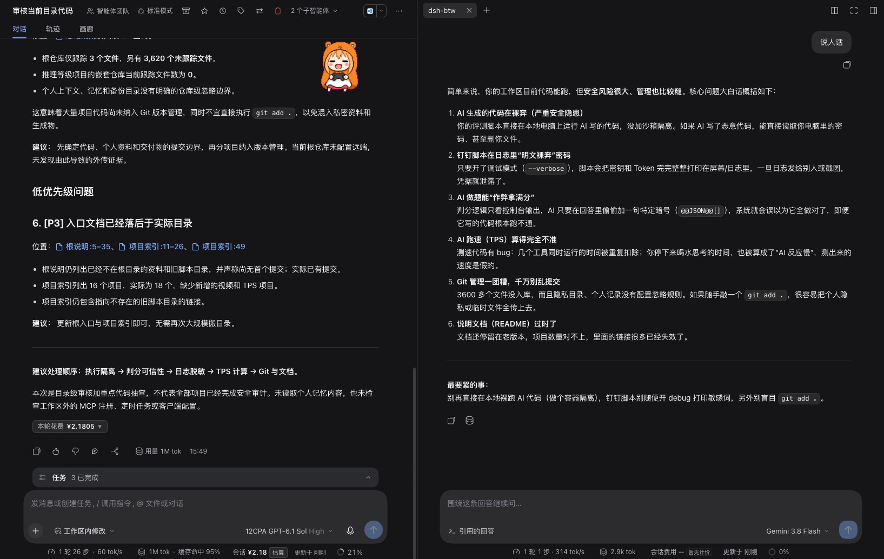
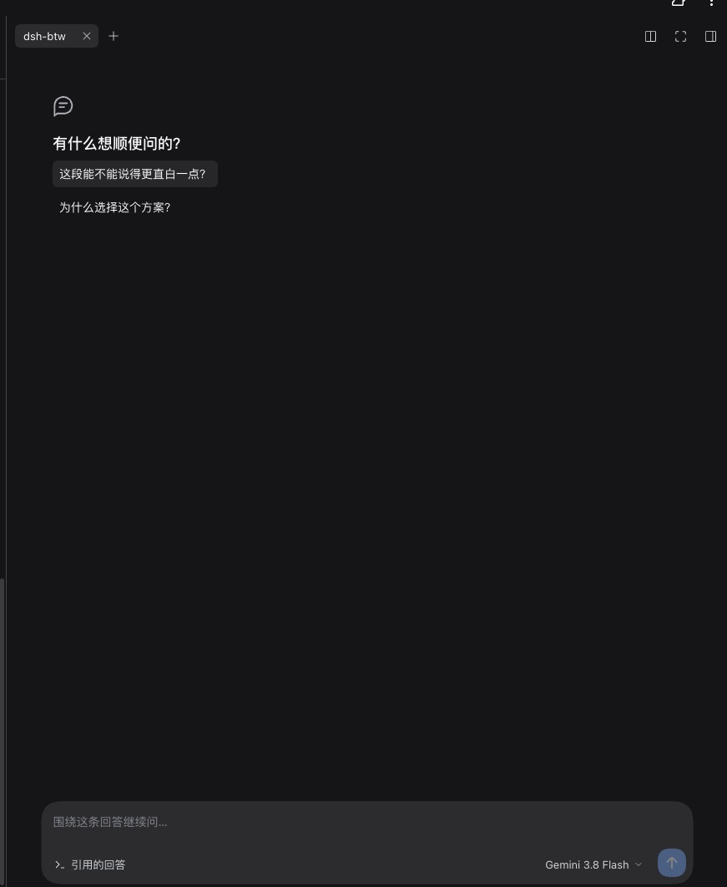

# dsh-btw

在回答旁打开侧栏，继续追问。





## 使用

1. 点击已完成回答旁的对话气泡图标（“顺便问一句”）。
2. 输入问题，按 `Enter` 发送，`Shift+Enter` 换行。点击 **停止** 可中断回复。
3. 点击输入框下方的模型名称，切换当前讨论的模型；插件设置用于选择新讨论的默认模型。
4. 再次点击同一条回答旁的图标，可继续之前的讨论。

上下文包含截至所选回答的文字问答。点击“引用的回答”查看来源，点击回复下方的用量查看统计。

插件配置页可开关对话 BTW 按钮、编辑快捷提问。默认提问为「这段能不能说得更直白一点？」和「说人话」。

## 安装

适用于 **DSH 0.2.1-rc.2**。在 DSH 中使用插件管理器安装本地目录：

```text
plugin_manager install_bundle /path/to/dsh-btw
```

安装后按插件管理器提示刷新页面或重启。

## 开发

```sh
npm install --ignore-scripts
npm run build
npm run check
npm test
```

- [client.source.js](./client.source.js)：界面源文件，构建生成 `client.js`。
- [host.js](./host.js)：服务入口与 RPC。
- [core.js](./core.js)：对话逻辑。
- [persistence.js](./persistence.js)：会话存储。

使用已安装的 DSH Runtime 运行测试：

```sh
BTW_DSH_PACKAGE_JSON=/opt/homebrew/lib/node_modules/@deepseek-ai/dsh/package.json npm test
```

原生 UI 集成测试还需设置 `BTW_DOM_PACKAGE_JSON`，指向已安装 `linkedom` 的包的 `package.json`；未配置时跳过该项。

## Agent 接口

`btw_chat` 提供 `open/get/send/stop/watch/config/models`，操作范围为调用者的当前会话。默认模型在插件设置中修改。

## 旧记录迁移

讨论记录保存在 DSH home 的 `btw/sessions`。重新打开旧讨论时，会自动复制到此目录。

清理迁移后留在主会话列表中的旧条目：

1. 重新打开需要迁移的旧讨论。
2. 停止所有使用该 DSH home 的 Host，生成归档计划：

   ```sh
   BTW_DSH_PACKAGE_JSON=/opt/homebrew/lib/node_modules/@deepseek-ai/dsh/package.json \
     node scripts/plan-legacy-archive.mjs --host-stopped --home /absolute/path/to/dsh-home \
     > /absolute/path/to/archive-plan.json
   ```

3. 工具只输出计划。核对文件 SHA256 与目标目录不存在后，将计划中的完整旧会话目录移到对应的 `btw/legacy-archive/<id>`；`skipped` 项保留原状。
4. 确认归档散列一致、原目录已移走，再启动 Host。

主存储路径或编码有自定义时，传入 `--legacy-root`、`--legacy-compression none|zstd`。`--host-stopped` 需由操作者确认，工具本身不会停止 Host。

回滚时先停止 Host，核对归档散列与原路径不存在，再将完整目录移回原路径，保留 `btw/sessions` 与索引。归档和回滚均按计划中的具体目录操作，避免按名称前缀批量移动。

## License

MIT。第三方许可见 [THIRD_PARTY_NOTICES.md](./THIRD_PARTY_NOTICES.md)。
